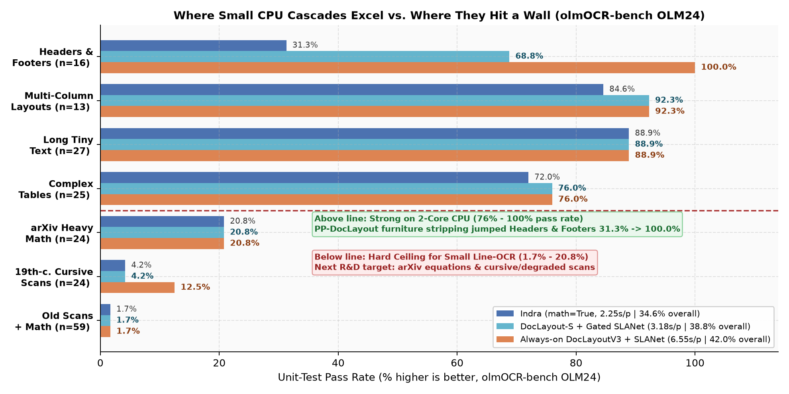
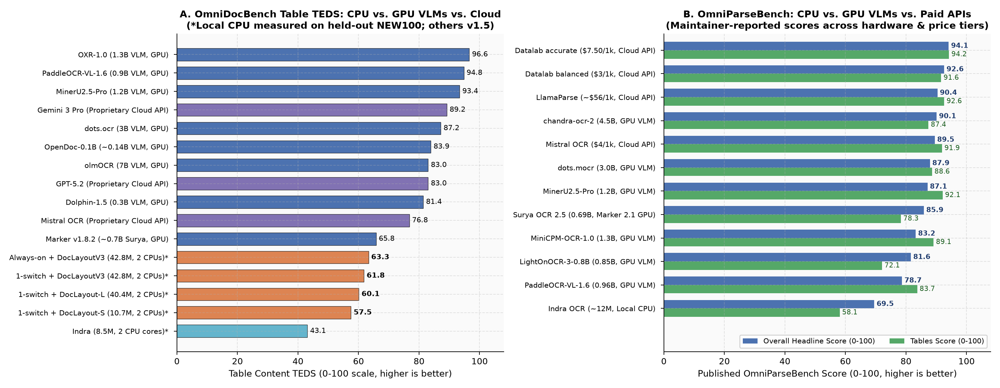

# toaster-ocr

Fast, CPU-only document OCR for low-power hardware (no GPU, no large VLM) — plus a full benchmark tracker across **2-Core CPU Cascades (`< 50M` params)** vs **GPU VLMs (`0.1B–8B`)** vs **Paid Cloud APIs (`Datalab`, `LlamaParse`, `Mistral`, `GPT`, `Gemini`)**.

Indra is already fast on CPU (~1.9 s/page on 2 ARM64 cores) and handles prose, reading order, and LaTeX math (`math=True`) well, **but** table structure (`0.431` TEDS) and Chinese character recognition (`0.132` ED) are weak spots.

`toaster-ocr` pairs Indra + `SLANet-1M` with your choice of `PP-DocLayout` detector (`S`, `M`, `L`, or `V3`) behind a simple page-level switch (`1-switch`), plus an optional line-level `PP-OCRv6` switch (`2-switch`) for Chinese/CJK documents:

1. **`indra` (`--mode indra`):** Native Indra (`math=True`) only (~1.9 s/page).
2. **`1-switch + DocLayout-S` (`--mode indra-pp --layout-model s`, 1.2M params, 5.2 MB):** Detector takes only **411 ms/page** (9.3x faster than `V3`), lifting Table TEDS from `0.431` to **`0.575`** (+14.4 pts) at **`3.44 s/page`** mean (`3.05 s` median).
3. **`1-switch + DocLayout-L` (`--mode indra-pp --layout-model l`, 30.9M params):** **`0.601` TEDS** (+17.0 pts) and **`0.248` Order ED** at **`5.29 s/page`**.
4. **`1-switch + DocLayoutV3` (`--mode indra-pp --layout-model v3`, 33.3M params):** **`0.618` TEDS** (+18.7 pts) at **`5.94 s/page`** on table-heavy `NEW100` (`4.12 s/page` mean / `3.31 s` median on `OLM24`).
5. **`Always-on + DocLayoutV3` (`--mode indra-pp --always-layout`):** Runs `PP-DocLayoutV3` on every page to catch rare tables Indra missed (**`0.633` TEDS** at **`7.00 s/page`**).
6. **`2-switch + PP-OCRv6` (`--mode pp-v6`, +21.2 MB ONNX):** Also re-reads low-confidence Indra lines (`conf <= 0.96`) with `PP-OCRv6_small_rec_onnx`, lifting **Simplified Chinese** Text Score from `0.871` to **`0.890`** (`25 wins / 1 loss`, `-1.89` pts ED) while leaving English virtually unchanged (`+0.17` pts).


---

## 1. Local 2-Core CPU Cascade Benchmarks (`NEW100` & `OLM24`)

Measured on CPUs `0,1` (`taskset -c 0,1 nice -n 10`, 2 intra-op threads, serial execution, `math=True` across all options). Both benchmarks are completely disjoint held-out sets. Raw metrics JSON: [`benchmarks/summary.json`](benchmarks/summary.json).

### Metric definitions
- **Table TEDS (Tree Edit Distance-based Similarity, higher is better):** Standard HTML table structure + cell content score (`0` to `1`, where `1.000` is an exact HTML tree and cell match).
- **Text Score (`1 - Edit Distance`, higher is better) / Text ED (lower is better):** Normalized character edit distance on matched text blocks (`Text ED = 0.0000` / `Text Score = 1.0000` is a perfect match).
- **Order ED (Reading-order Edit Distance, lower is better):** Normalized edit distance on block reading order.
- **Pass rate (higher is better):** Percentage of deterministic `olmOCR-bench` unit tests passed.

### Held-out OmniDocBench (`NEW100`: 100 unseen pages, 60% table / 40% control, 50 EN / 50 ZH)

| Configuration | Detector params | Detector alone (mean / med) | Layout run on | Total / page (mean / med) | Table TEDS (higher is better) | TEDS struct-only (higher is better) | Text ED all / EN / ZH (lower is better) | Order ED (lower is better) |
|---|---:|---:|---:|---:|---:|---:|---:|---:|
| **`indra`** (`math=True`) | `0` | `0 ms` | `0%` | **1.91 s** (`1.63 s`) | `0.4308` | `0.6023` | `0.1329` / `0.1342` / `0.1317` | `0.2978` |
| **`1-switch + DocLayout-S`** | **1.21M** (5.2 MB) | **411 ms** (`361 ms`) | **72%** | **3.44 s** (`3.05 s`) | **`0.5747`** | `0.7491` | `0.1321` / `0.1342` / `0.1302` | `0.2839` |
| **`Always-on + DocLayout-S`** | 1.21M | `411 ms` (`361 ms`) | `100%` | `3.58 s` (`3.12 s`) | `0.5799` | `0.7543` | `0.1411` / `0.1538` / `0.1297` | `0.2941` |
| **`1-switch + DocLayout-M`** | 5.65M (23.8 MB) | `1,224 ms` (`1,172 ms`) | `72%` | `4.06 s` (`3.71 s`) | `0.5663` | `0.7399` | `0.1489` / `0.1726` / `0.1277` | `0.2898` |
| **`1-switch + DocLayout-L`** | **30.94M** (130 MB) | `2,923 ms` (`2,880 ms`) | **72%** | **5.29 s** (`5.49 s`) | **`0.6006`** | `0.7625` | `0.1321` / `0.1342` / `0.1302` | **`0.2479`** |
| **`Always-on + DocLayout-L`** | 30.94M | `2,923 ms` (`2,880 ms`) | `100%` | `6.12 s` (`5.67 s`) | `0.6058` | `0.7677` | `0.1321` / `0.1342` / `0.1302` | **`0.2479`** |
| **`1-switch + DocLayoutV3`** | **33.29M** (133 MB) | `3,807 ms` (`3,690 ms`) | **72%** | **5.94 s** (`6.24 s`) | **`0.6177`** | `0.7736` | `0.1317` / `0.1349` / `0.1287` | `0.2722` |
| **`Always-on + DocLayoutV3`** | 33.29M | `3,807 ms` (`3,690 ms`) | `100%` | **7.00 s** (`6.43 s`) | **`0.6333`** | **`0.7892`** | `0.1317` / `0.1349` / `0.1287` | `0.2722` |
| **`2-switch (V3 + PP-OCRv6 <=0.96)`** | 33.29M + 9.2M | `3,807 ms` | **72%** | **8.85 s** (`8.47 s`) | **`0.6177`** | `0.7736` | **`0.1209`** / `0.1332` / **`0.1098`** | `0.2683` |
| **`PP-OCRv6 100% (always-on)`** | 33.29M + 9.2M | `3,807 ms` | `100%` | `9.91 s` (`9.27 s`) | `0.6333` | `0.7892` | **`0.1197`** / `0.1320` / **`0.1088`** | `0.2683` |

---

## 2. Where Small CPU Cascades Excel vs. Where They Hit a Wall (`olmOCR-bench OLM24`)

In addition to table boxes, `PP-DocLayout` detects `header`, `footer`, `header_image`, `footer_image`, and `number` (page-number) boxes. Stripping non-table lines inside those furniture regions (enabled by default; disable with `--keep-furniture`) lifts **`headers_footers` from `31.3%` (`5/16`) to `68.8%` (`11/16`) with `DocLayout-S` (`3.18 s/page`) and `100.0%` (`16/16`) with `Always-on + DocLayoutV3` (`6.55 s/page`)**, bringing all four modern printed PDF categories to **`76.0%–100.0%` pass rates**.

Meanwhile, on 19th-century cursive handwriting (`old_scans` `12.5%`, `old_scans_math` `1.7%`) and heavy arXiv equations (`arxiv_math` `20.8%`), small line-OCR + `MathReader` hit a hard ceiling — making difficult arXiv math and degraded scans our next R&D target:



| Option | Detector run on | Mean / page (median) | Overall pass rate (higher is better) | `headers_footers` | `multi_column` | `long_tiny_text` | `table_tests` | `arxiv_math` | `old_scans` | `old_scans_math` |
|---|---:|---:|---:|---:|---:|---:|---:|---:|---:|---:|
| **`indra`** (`math=True`) | `0%` | **2.25 s** (`1.70 s`) | `34.57%` (`65/188`) | `31.3%` | `84.6%` | `88.9%` | `72.0%` | `20.8%` | `4.2%` | `1.7%` |
| **`1-switch + DocLayout-S`** | **37.5%** | **2.66 s** (**`2.03 s`**) | `35.64%` (`67/188`) | `31.3%` | **`92.3%`** | `88.9%` | **`76.0%`** | `20.8%` | `4.2%` | `1.7%` |
| **`DocLayout-S + Gated SLANet`** | `100%` | **3.18 s** (**`2.59 s`**) | **`38.83%`** (`73/188`) | **`68.8%`** | **`92.3%`** | `88.9%` | **`76.0%`** | `20.8%` | `4.2%` | `1.7%` |
| **`1-switch + DocLayoutV3`** | **37.5%** | **4.00 s** (**`3.31 s`**) | **`38.83%`** (`73/188`) | **`68.8%`** | **`92.3%`** | `88.9%` | **`76.0%`** | `20.8%` | `4.2%` | `1.7%` |
| **`Always-on + DocLayoutV3`** | `100%` | **6.55 s** (`6.05 s`) | **`42.02%`** (`79/188`) | **`100.0%`** | **`92.3%`** | `88.9%` | **`76.0%`** | `20.8%` | **`12.5%`** | `1.7%` |

---

## 3. The Bigger Picture: 2-Core CPU vs. GPU VLMs (`0.1B–8B`) vs. Cloud APIs

How does a `< 50M` parameter CPU-only stack compare against GPU pipelines (`Marker`, `OpenDoc-0.1B`), `1B–7B` vision-language models (`LightOnOCR-3-0.8B`, `PaddleOCR-VL-1.6`, `MinerU2.5-Pro`, `MiniCPM-OCR-1.0`, `dots.ocr`, `olmOCR-7B`, `chandra-ocr-2`), and paid cloud APIs (`Datalab`, `LlamaParse`, `Mistral OCR`, `GPT-5.2`, `Gemini 3 Pro`)?



### A. OmniDocBench Comparison (Local CPU `NEW100` vs. Published `OmniDocBench v1.5` GPU/Cloud)
*(Note: Our local CPU rows were measured on the 100-page held-out `NEW100` subset on 2 ARM64 CPU cores; external rows are maintainer-reported on the 1,355-page `OmniDocBench v1.5` split and are shown for hardware-tier context rather than direct same-split ranking.)*

| System | Hardware Tier | Total Params | Table TEDS ↑ | Table TEDS-S ↑ | Text Edit ↓ | Read Order Edit ↓ | Provenance / Split |
|---|---|---:|---:|---:|---:|---:|---|
| **`Indra (math=True)`** | **Local 2-Core CPU** | `~8.5M` | `43.08` | `60.23` | `0.1329` | `0.2978` | Measured locally (`NEW100`, 1.91s/p) |
| **`1-switch + DocLayout-S`** | **Local 2-Core CPU** | **`~10.7M`** | **`57.47`** | **`74.91`** | `0.1321` | `0.2839` | Measured locally (`NEW100`, 3.44s/p) |
| **`1-switch + DocLayout-L`** | **Local 2-Core CPU** | `~40.4M` | **`60.06`** | **`76.25`** | `0.1321` | **`0.2479`** | Measured locally (`NEW100`, 5.29s/p) |
| **`1-switch + DocLayoutV3`** | **Local 2-Core CPU** | `~42.8M` | **`61.77`** | **`77.36`** | `0.1317` | `0.2722` | Measured locally (`NEW100`, 5.94s/p) |
| **`Always-on + DocLayoutV3`** | **Local 2-Core CPU** | `~42.8M` | **`63.33`** | **`78.92`** | `0.1317` | `0.2722` | Measured locally (`NEW100`, 7.00s/p) |
| **`2-switch + PP-OCRv6`** | **Local 2-Core CPU** | `~51M` | `61.77` | `77.36` | **`0.1209`** | `0.2683` | Measured locally (`NEW100`, 8.85s/p) |
| `Marker v1.8.2` | GPU Pipeline (`Surya`) | `~0.7B` | `65.77` | `73.24` | `0.1570` | `0.2430` | Published OmniDocBench v1.5 |
| `Mistral OCR` | Proprietary Cloud API | Closed | `76.78` | `80.93` | `0.0970` | `0.1710` | Published OmniDocBench v1.5 |
| `Dolphin-1.5` | Open GPU VLM | `0.3B` | `81.43` | `84.82` | `0.0940` | `0.1670` | Published OmniDocBench v1.5 |
| `GPT-5.2` | Proprietary Cloud API | Closed | `82.95` | `87.93` | `0.1140` | `0.1930` | Published OmniDocBench v1.5 |
| `olmOCR` | Open GPU VLM | `7B` | `83.00` | `87.17` | `0.1390` | `0.2160` | Published OmniDocBench v1.5 |
| `OpenDoc-0.1B` | Open GPU Pipeline | `~0.14B` | `83.88` | `87.45` | `0.0490` | `0.1400` | Published OmniDocBench v1.5 |
| `dots.ocr` | Open GPU VLM | `3B` | `87.18` | `90.58` | `0.0480` | `0.1380` | Published OmniDocBench v1.5 |
| `Gemini 3 Pro` | Proprietary Cloud API | Closed | `89.15` | `92.96` | `0.0640` | `0.1650` | Published OmniDocBench v1.5 |
| `MinerU2.5-Pro` | Open GPU VLM | `1.2B` | `93.42` | `95.92` | `0.0360` | `0.1200` | Published OmniDocBench v1.5 |
| `PaddleOCR-VL-1.6` | Open GPU VLM | `0.9B` | `94.76` | `97.10` | `0.0326` | `0.1278` | Published OmniDocBench v1.5 |
| `OXR-1.0` | Open GPU VLM | `1.3B` | `96.61` | `98.44` | `0.0244` | `0.1216` | Published OmniDocBench v1.5 |

### B. Published OmniParseBench Leaderboard (CPU vs. Open GPU VLMs vs. Paid Cloud APIs)
*(Maintainer-reported scores from Datalab's `OmniParseBench` across hardware and API pricing tiers.)*

| System | Access / Tier | Params / Price per 1k pages | Headline ↑ | Text ↑ | Tables ↑ | Layout ↑ |
|---|---|---|---:|---:|---:|---:|
| **`Datalab accurate`** | Closed Cloud API | `$7.50 / 1k` | **`94.1`** | `92.0` | `94.2` | `96.0` |
| `Gemini 3.8 Flash` | Closed Cloud API | `~$37.08 / 1k` | `92.9` | `91.3` | `95.2` | `92.2` |
| **`Datalab balanced`** | Closed Cloud API | `$3.00 / 1k` | **`92.6`** | `90.1` | `91.6` | `96.2` |
| `GPT-6.1 Sol` | Closed Cloud API | `$30.95 / 1k` | `91.5` | `89.8` | `95.6` | `89.1` |
| **`LlamaParse`** | Closed Cloud API | `~$56.25 / 1k` | **`90.4`** | `88.2` | `92.6` | `90.4` |
| `chandra-ocr-2` (Datalab) | Open GPU VLM | `4.5B` | `90.1` | `87.4` | `87.4` | `95.4` |
| `Mistral OCR` | Closed Cloud API | `$4.00 / 1k` | `89.5` | `82.8` | `91.9` | `93.8` |
| `dots.mocr` | Open GPU VLM | `3.0B` | `87.9` | `82.5` | `88.6` | `92.5` |
| `MinerU2.5-Pro` | Open GPU VLM | `1.2B` | `87.1` | `77.4` | `92.1` | `91.7` |
| **`Surya OCR 2.5`** (Marker 2.1 engine) | Open GPU VLM | `0.69B` | **`85.9`** | `83.8` | `78.3` | `95.7` |
| `MiniCPM-OCR-1.0` | Open GPU VLM | `1.3B` | `83.2` | `72.8` | `89.1` | `87.6` |
| `LightOnOCR-3-0.8B` | Open GPU VLM | `0.85B` | `81.6` | `81.1` | `72.1` | `91.7` |
| `PaddleOCR-VL-1.6` | Open GPU VLM | `0.96B` | `78.7` | `61.7` | `83.7` | `90.7` |
| **`Indra OCR`** (baseline) | **Open Local CPU** | **`~12M ($0)`** | **`69.5`** | `60.3` | `58.1` | `90.1` |

---

## Quickstart

### 1. Install
```bash
git clone https://github.com/Im-Jam/toaster-ocr.git
cd toaster-ocr
python3 -m venv .venv
source .venv/bin/activate
pip install -e ".[all]"
```

### 2. Download pinned upstream models
No model weights are bundled in this repo. Fetch pinned revisions into `~/.cache/toaster-ocr` (override with `TOASTER_OCR_HOME`):
```bash
# Fast 5 MB layout detector (PP-DocLayout-S) + Indra + SLANet:
toaster-ocr download indra doclayout-s slanet

# Or download PP-DocLayoutV3 / L / PP-OCRv6:
toaster-ocr download ppv3 doclayout-l ppv6
```

### 3. Run OCR on an image
```bash
# Fast native Indra only (~1.9s/page)
toaster-ocr run page.png --mode indra

# 1-switch with ultra-fast PP-DocLayout-S (~3.4s/page, 0.575 TEDS)
toaster-ocr run page.png --mode indra-pp --layout-model s

# 1-switch with PP-DocLayoutV3 (~5.9s/page on table-heavy docs, 0.618 TEDS)
toaster-ocr run page.png --mode indra-pp --layout-model v3

# 2-switch (+ PP-OCRv6 for Chinese/CJK documents)
toaster-ocr run page.png --mode pp-v6 --layout-model v3
```

### 4. Start OpenAI-compatible HTTP server
Exposes `indra-ocr-local`, `indra-pp-local`, and `pp-v6-local` on `/v1/models`, `/v1/chat/completions` (base64 `image_url`), and `/v1/ocr`:
```bash
TOASTER_OCR_API_KEY="your-local-key" toaster-ocr serve --host 127.0.0.1 --port 8080
```

## Licensing

Newly authored code in this repository is licensed under the **Apache License 2.0** (`LICENSE`). Upstream models and datasets carry separate terms (see [`THIRD_PARTY_NOTICES.md`](THIRD_PARTY_NOTICES.md): notably `datalab-to/indra-ocr` model weights use modified **AI Pubs OpenRAIL-M** terms and OmniDocBench is research-only).
