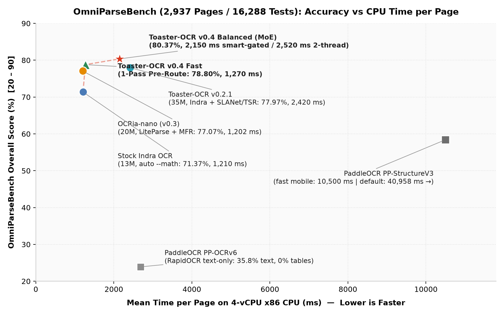
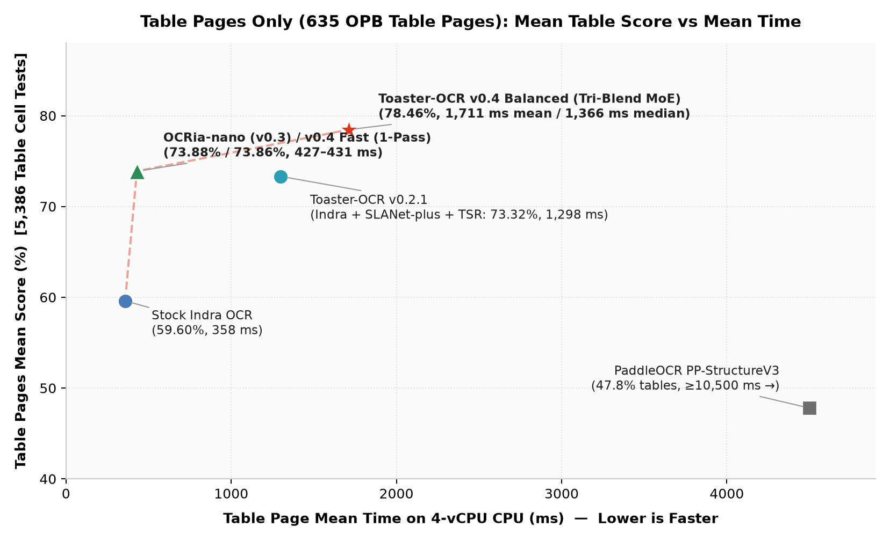
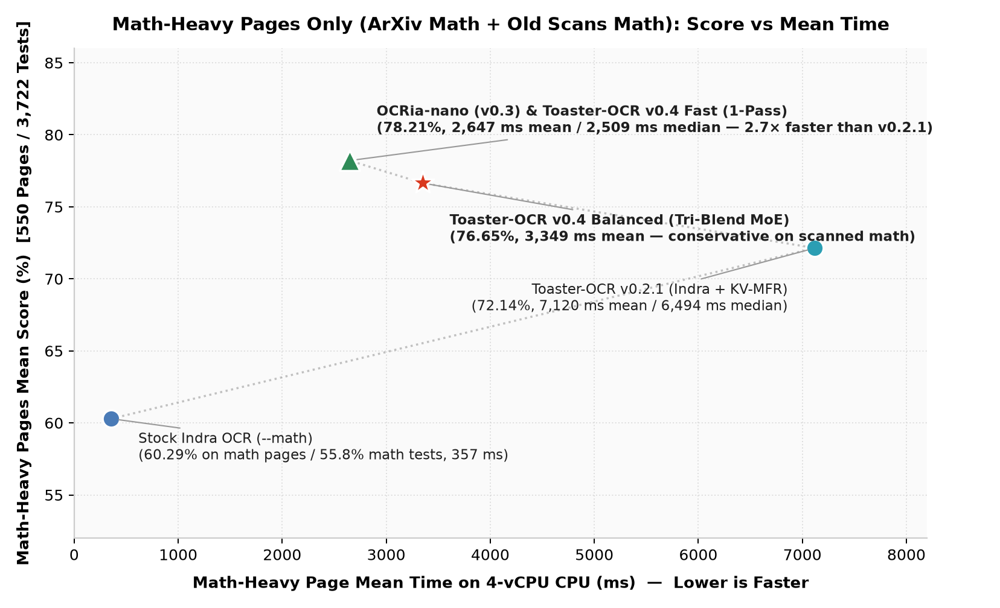
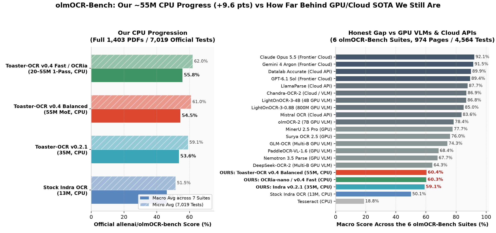

# toaster-ocr (`v0.4`)

**Pure-ONNX, CPU-only document OCR (~55M total parameters across both specialist engines)** — no GPU, no PyTorch, no PaddlePaddle required.

Most open-source OCR setups force a choice between slow heavyweight pipelines (like PaddleOCR's full document stack, which takes 10–40 seconds a page on CPU) or big multi-billion-parameter Vision-Language Models that need a GPU.

`toaster-ocr v0.4` pairs two tiny CPU specialist stacks — **Indra OCR** (`v0.2.1`, with `SLANet-plus` + `DeepDoc TSR` + `PP-DocLayout-S` + KV-cached `pix2text-mfr-1.5`) and **LiteParse / OCRia-nano-1** (`v0.3`, with `LayoutNet` + `PP-DocLayout-S` + `QInt8` KV-cached `pix2text-mfr-1.5`) — in two operating modes:

- **Fast mode (`--mode fast`, 1-Pass Pre-Route):** Sends PDFs to `OCRia-nano-1 + KV-MFR` and standalone images to `Indra v0.2.1`. Runs only one engine per page (**`78.80%`** on full OmniParseBench at **`1,270 ms/page` mean / `810 ms` median**).
- **Balanced mode (`--mode balanced`, System MoE v4):** Combines both engines on table and math pages using an anatomical + DOM table arbiter and Jaccard slot-aligned table replacement (**`80.37%`** on full OmniParseBench at **`2,150 ms/page` smart-gated / `2,520 ms` 2-thread mean**).

---

## Full 2,937-Page / 16,288-Test OmniParseBench Results

All numbers below are from the full 2,937-page, 16,288-test [OmniParseBench](https://github.com/datalab-to/omni_parse_bench) suite on 4-vCPU x86 CPU workers (PaddleOCR reference timings from the official 4-vCPU x86 OPB benchmark harness):

<p align="center">
  
</p>

| System (all 2,937 pages / 16,288 tests, CPU-only) | OPB Headline | Tests Passed | Text | Tables | Layout | Mean ms / page | Median ms / page |
|---|---:|---:|---:|---:|---:|---:|---:|
| PaddleOCR `PP-OCRv6` small (RapidOCR, text only) | ~23.9% | — | 35.80% | 0.00% | — | — | 2,685 ms |
| PaddleOCR `PP-StructureV3` (full doc pipeline) | 58.40% | — | 55.60% | 47.80% | 71.70% | — | 10,500–40,958 ms |
| Stock `Indra OCR` (`1.1.2`, `--math` auto) | 71.37% | 10,736 | 62.55% | 59.60% | 91.97% | ~1,210 ms | 357 ms |
| `toaster-ocr v0.3` (`OCRia-nano-1 + KV-MFR`) | 77.07% | 11,828 | 66.74% | 73.88% | 90.60% | 1,202 ms | 860 ms |
| `toaster-ocr v0.2.1` (`Indra + SLANet/TSR + KV-MFR`) | 77.97% | 12,044 | 69.49% | 73.32% | 91.09% | 2,420 ms | 1,210 ms |
| **`toaster-ocr v0.4` Fast (`--mode fast`, 1-Pass)** | **78.80%** | **12,244** | **71.53%** | **73.86%** | **91.01%** | **1,270 ms** | **810 ms** |
| **`toaster-ocr v0.4` Balanced (`--mode balanced`, MoE)** | **80.37%** | **12,487** | **71.40%** | **78.46%** | **91.26%** | **2,150 ms** | **1,350 ms** |

---

## Table Pages Only & Math-Heavy Pages Only

When you break the benchmark down by document type, the two specialist engines complement each other cleanly:

### 1. Table Pages Only (`635` OPB Table Pages / `5,386` Table Cell Tests)

<p align="center">
  
</p>

On table pages, `OCRia-nano-1` (`73.88%` @ `427 ms` mean) and `Indra v0.2.1` (`73.32%` @ `1,298 ms` mean) have nearly identical average scores, yet they fail on completely different tables (their per-page oracle on table pages is `85.57%`). Using internal ONNX detector confidence (`DeepDoc TSR` row scores, `SLANet-plus` tag probabilities, and `LiteParse` complexity flags) plus DOM column-type coherence pushes table accuracy to **`78.46%` (`+5.14 pts`)** without duplicating tables.

### 2. Math-Heavy Pages Only (`550` ArXiv & Old-Scans Math Pages / `3,722` Tests)

<p align="center">
  
</p>

On math-heavy PDFs (`olmo_arxiv_math` + `olmo_old_scans_math`), `OCRia-nano-1` / `v0.4 Fast` is both **`2.7×` faster** than `v0.2.1` (`2,647 ms` vs `7,120 ms` mean) and scores **`78.21%`** (up from `60.29%` on stock Indra).

---

## Honest Comparison vs GPU VLMs & Cloud APIs (`allenai/olmOCR-bench`)

To be completely transparent about where a ~55M-parameter CPU pipeline stands relative to multi-billion-parameter GPU Vision-Language Models and commercial cloud APIs, here are the scores on AllenAI's independent **[olmOCR-bench](https://huggingface.co/datasets/allenai/olmOCR-bench)** (`1,403` PDFs / `7,019` official tests, plus the 6 `olmOCR-bench` suites on the OPB leaderboard):

<p align="center">
  
</p>

| System | Full `allenai/olmOCR-bench` Macro (`7` Suites) | Full `allenai/olmOCR-bench` Micro (`7,019` Tests) | Hardware / Footprint |
|---|---:|---:|---|
| Stock `Indra OCR` (`1.1.2`) | `46.12%` | `51.52%` (`3,616 / 7,019`) | ~13M Pure-ONNX CPU |
| `toaster-ocr v0.2.1` (`Indra` base) | `53.60%` | `59.13%` (`4,150 / 7,019`) | ~35M Pure-ONNX CPU |
| **`toaster-ocr v0.4` Balanced (MoE)** | **`54.49%`** | **`60.98%` (`4,280 / 7,019`)** | **~55M Pure-ONNX CPU** |
| **`toaster-ocr v0.4` Fast / `OCRia-nano`** | **`55.75%`** | **`61.99%` (`4,351 / 7,019`)** | **~20–55M Pure-ONNX CPU** |

We gained **`+9.63` macro points (`+735` net tests)** over stock Indra on `olmOCR-bench` while staying 100% on CPU — but as the right-hand chart shows, 7B+ GPU VLMs (`olmOCR-2`, `MinerU 2.5 Pro`, `LightOnOCR-3`) and frontier cloud APIs (`Datalab`, `Gemini`, `Claude`) still sit `18–32` points higher on degraded historical scans, handwriting, and complex multi-column headers/footers.

---

## Quickstart

```bash
pip install git+https://github.com/Im-Jam/toaster-ocr.git

# Optional: include indra-ocr for full dual-engine `fast` (image) and `balanced` (MoE) modes
pip install "toaster-ocr[indra] @ git+https://github.com/Im-Jam/toaster-ocr.git"

# 1. Fetch pinned models and build QInt8 KV-cached MFR decoders locally:
toaster-ocr download

# 2. OCR an image or PDF to Markdown (--mode fast | balanced | ocria | indra):
toaster-ocr ocr document.pdf -o document.md --mode fast --threads 2
toaster-ocr ocr table_report.pdf -o table_report.md --mode balanced --threads 2

# 3. Or launch the OpenAI-compatible HTTP server:
toaster-ocr serve --host 127.0.0.1 --port 8129 --threads 2
```

### Python API

```python
from toaster_ocr import ToasterOCR

engine = ToasterOCR(threads=2, mode="fast")   # or mode="balanced"
res = engine.read("document.pdf")
print(res.markdown)
print(res.elapsed_seconds, res.stats)
```

---

## Licensing & Provenance

The integration code in this repository is **Apache-2.0** (`LICENSE`). Model weights are downloaded on demand from Hugging Face / LiteParse under their own upstream licenses — notably `OCRia-nano-1` and `Indra OCR` weights are **Modified AI Pubs OpenRAIL-M**, `LiteParse`, `SLANet-plus`, `DeepDoc TSR`, and `PP-DocLayout-S-ONNX` are **Apache-2.0**, and `pix2text-mfr-1.5` is **MIT**. See [`THIRD_PARTY_NOTICES.md`](THIRD_PARTY_NOTICES.md).
