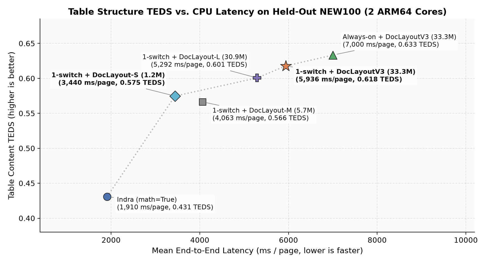

# toaster-ocr

Fast, CPU-only document OCR for low-power hardware (no GPU, no large VLM).

Indra is already fast on CPU (~1.9 s/page on 2 ARM64 cores) and handles prose, reading order, and LaTeX math (`math=True`) well, **but** table structure was a major weak spot (`0.431` TEDS).

`toaster-ocr` pairs Indra + `SLANet-1M` with your choice of `PP-DocLayout` detector (`S`, `M`, `L`, or `V3`) behind a simple page-level switch (`1-switch`): run Indra first, and only run the layout detector + `SLANet-1M` when Indra detects a table:

1. **`indra` (`--mode indra`):** Native Indra (`math=True`) only (~1.9 s/page).
2. **`1-switch + DocLayout-S` (`--mode indra-pp --layout-model s`, 1.2M params, 5.2 MB):** Detector takes only **411 ms/page** (9.3x faster than `V3`), lifting Table TEDS from `0.431` to **`0.575`** (+14.4 pts) at **`3.44 s/page`** mean (`3.05 s` median).
3. **`1-switch + DocLayout-L` (`--mode indra-pp --layout-model l`, 30.9M params):** **`0.601` TEDS** (+17.0 pts) and **`0.248` Order ED** at **`5.29 s/page`**.
4. **`1-switch + DocLayoutV3` (`--mode indra-pp --layout-model v3`, 33.3M params):** **`0.618` TEDS** (+18.7 pts) at **`5.94 s/page`** on table-heavy `NEW100` (`4.12 s/page` mean / `3.31 s` median on `OLM24`).
5. **`Always-on + DocLayoutV3` (`--mode indra-pp --always-layout`):** Runs `PP-DocLayoutV3` on every page to catch rare tables Indra missed (**`0.633` TEDS** at **`7.00 s/page`**).



---

## Benchmarks (2 ARM64 CPU cores, no GPU)

Measured on CPUs `0,1` (`taskset -c 0,1 nice -n 10`, 2 intra-op threads, serial execution, `math=True` across all options). Both benchmarks are completely disjoint held-out sets. Raw metrics JSON: [`benchmarks/summary.json`](benchmarks/summary.json).

### Metric definitions
- **Table TEDS (Tree Edit Distance-based Similarity, higher is better):** Standard HTML table structure + cell content score (`0` to `1`, where `1.000` is an exact HTML tree and cell match).
- **Text ED (Edit Distance, lower is better):** Normalized character edit distance on matched text blocks (`0.0000` is a perfect match).
- **Order ED (Reading-order Edit Distance, lower is better):** Normalized edit distance on block reading order.
- **Pass rate (higher is better):** Percentage of deterministic `olmOCR-bench` unit tests passed.

### 1. Held-out OmniDocBench (`NEW100`: 100 unseen pages, 60% table / 40% control, 50 EN / 50 ZH)

| Configuration | Detector params | Detector alone (mean / med) | Layout run on | Total / page (mean / med) | Table TEDS (higher is better) | TEDS struct-only (higher is better) | Text ED page avg (lower is better) | Order ED (lower is better) |
|---|---:|---:|---:|---:|---:|---:|---:|---:|
| **`indra`** (`math=True`) | `0` | `0 ms` | `0%` | **1.91 s** (`1.63 s`) | `0.4308` | `0.6023` | `0.1329` | `0.2978` |
| **`1-switch + DocLayout-S`** | **1.21M** (5.2 MB) | **411 ms** (`361 ms`) | **72%** | **3.44 s** (`3.05 s`) | **`0.5747`** | `0.7491` | `0.1321` | `0.2839` |
| **`Always-on + DocLayout-S`** | 1.21M | `411 ms` (`361 ms`) | `100%` | `3.58 s` (`3.12 s`) | `0.5799` | `0.7543` | `0.1411` | `0.2941` |
| **`1-switch + DocLayout-M`** | 5.65M (23.8 MB) | `1,224 ms` (`1,172 ms`) | `72%` | `4.06 s` (`3.71 s`) | `0.5663` | `0.7399` | `0.1489` | `0.2898` |
| **`1-switch + DocLayout-L`** | **30.94M** (130 MB) | `2,923 ms` (`2,880 ms`) | **72%** | **5.29 s** (`5.49 s`) | **`0.6006`** | `0.7625` | `0.1321` | **`0.2479`** |
| **`Always-on + DocLayout-L`** | 30.94M | `2,923 ms` (`2,880 ms`) | `100%` | `6.12 s` (`5.67 s`) | `0.6058` | `0.7677` | `0.1321` | `0.2479` |
| **`1-switch + DocLayoutV3`** | **33.29M** (133 MB) | `3,807 ms` (`3,690 ms`) | **72%** | **5.94 s** (`6.24 s`) | **`0.6177`** | `0.7736` | **`0.1317`** | `0.2722` |
| **`Always-on + DocLayoutV3`** | 33.29M | `3,807 ms` (`3,690 ms`) | `100%` | **7.00 s** (`6.43 s`) | **`0.6333`** | **`0.7892`** | **`0.1317`** | `0.2722` |

#### Key findings across `S`, `M`, `L`, and `V3`
- **`PP-DocLayout-S` (`1.21M`) beats `M` (`5.65M`) in both speed and accuracy:** `S` runs its detector in **411 ms** (`3.0x` faster than `M`'s `1,224 ms`) and scores higher on Table TEDS (`0.5747` vs `0.5663`) and Text ED (`0.1321` vs `0.1489`).
- **Why `1-switch` helps `DocLayout-S` on text:** When `DocLayout-S` runs on every page (`Always-on`), it occasionally predicts a false-positive table box on plain prose (`0.1411` Text ED); gating it with `1-switch` (`has_indra_table`) eliminates those false positives (`0.1321` Text ED).
- **Smooth Pareto frontier:** `Indra` (`1.91s, 0.431`) -> `S 1-switch` (`3.44s, 0.575`) -> `L 1-switch` (`5.29s, 0.601`) -> `V3 1-switch` (`5.94s, 0.618`) -> `V3 Always-on` (`7.00s, 0.633`).

### 2. olmOCR-bench Stratified Pilot (`OLM24`: 24 pages, 188 official unit tests)

| Option | Layout run on | Mean / page (median) | Overall pass rate (higher is better) | `long_tiny_text` | `multi_column` | `table_tests` | `headers_footers` | `arxiv_math` | `old_scans` | `old_scans_math` |
|---|---:|---:|---:|---:|---:|---:|---:|---:|---:|---:|
| **`indra`** (`math=True`) | `0%` | **2.25 s** (`1.70 s`) | `34.57%` (`65/188`) | `88.9%` | `84.6%` | `72.0%` | `31.3%` | `20.8%` | `4.2%` | `1.7%` |
| **`1-switch + DocLayoutV3`** | **37.5%** | **4.12 s** (**`3.31 s`**) | **`35.64%`** (`67/188`) | `88.9%` | **`92.3%`** | **`76.0%`** | `31.3%` | `20.8%` | `4.2%` | `1.7%` |
| **`Always-on + DocLayoutV3`** | `100%` | **6.68 s** (`5.95 s`) | **`35.64%`** (`67/188`) | `88.9%` | **`92.3%`** | **`76.0%`** | `31.3%` | `20.8%` | `4.2%` | `1.7%` |

### Optional Chinese / CJK text switch (`--mode pp-v6`)
We also tested routing low-confidence Indra lines (`conf <= 0.96`) to `PP-OCRv6_small_rec_onnx` (21.2 MB ONNX). On **English**, it added ~3 to 4 s/page for negligible gain (`0.1349 -> 0.1332` ED on `NEW100`; `66/188` vs `67/188` on `OLM24`), so it is **not** needed for English. On **Simplified Chinese** (`NEW100`, `n=48`), it cut Text ED from `0.1287` to `0.1098` (`25 wins / 1 loss`), so `--mode pp-v6` remains available if you process Chinese documents.

---

## Quickstart

### 1. Install
```bash
git clone https://github.com/Im-Jam/toaster-ocr.git
cd toaster-ocr
python3 -m venv .venv
source .venv/bin/activate
pip install -e ".[all]"
```

### 2. Download pinned upstream models
No model weights are bundled in this repo. Fetch pinned revisions into `~/.cache/toaster-ocr` (override with `TOASTER_OCR_HOME`):
```bash
# Fast 5 MB layout detector (PP-DocLayout-S) + Indra + SLANet:
toaster-ocr download indra doclayout-s slanet

# Or download PP-DocLayoutV3 / L:
toaster-ocr download ppv3 doclayout-l
```

### 3. Run OCR on an image
```bash
# Fast native Indra only (~1.9s/page)
toaster-ocr run page.png --mode indra

# 1-switch with ultra-fast PP-DocLayout-S (~3.4s/page, 0.575 TEDS)
toaster-ocr run page.png --mode indra-pp --layout-model s

# 1-switch with PP-DocLayoutV3 (~5.9s/page on table-heavy docs, 0.618 TEDS)
toaster-ocr run page.png --mode indra-pp --layout-model v3

# Always-on tables with PP-DocLayoutV3 (0.633 TEDS)
toaster-ocr run page.png --mode indra-pp --layout-model v3 --always-layout
```

### 4. Start OpenAI-compatible HTTP server
Exposes `indra-ocr-local`, `indra-pp-local`, and `pp-v6-local` on `/v1/models`, `/v1/chat/completions` (base64 `image_url`), and `/v1/ocr`:
```bash
TOASTER_OCR_API_KEY="your-local-key" toaster-ocr serve --host 127.0.0.1 --port 8080
```

---

## Honest Limits & Next Focus

- **Where this CPU stack struggles (next thing to explore):** On 19th-century cursive handwriting (`old_scans` `1/24` and `old_scans_math` `1/59`) and heavy arXiv equations (`arxiv_math` `5/24`), small printed-line OCR + `MathReader` hit a hard ceiling. Finding better compact math/hard-text components for those failure cases is the next step.
- **Scoring notes:** OmniDocBench `NEW100` omits CDM; `OLM24` runs unmodified `allenai/olmocr` `tests.py` for `present`/`absent`/`order`/`table` and KaTeX 0.16.22 MathML symbol equivalence (`omni_parse_bench.equations`) for `math`.
- **Platform tested:** Benchmarks were measured on Linux ARM64 CPU; x86/macOS/Windows work in standard Python environments when dependencies are installed, but exact CPU timings will vary by hardware.

## Licensing

Newly authored code in this repository is licensed under the **Apache License 2.0** (`LICENSE`). Upstream models and datasets carry separate terms (see [`THIRD_PARTY_NOTICES.md`](THIRD_PARTY_NOTICES.md): notably `datalab-to/indra-ocr` model weights use modified **AI Pubs OpenRAIL-M** terms and OmniDocBench is research-only).
